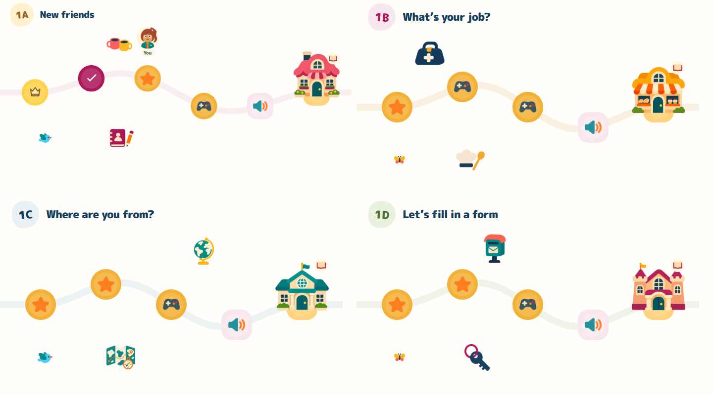

# Unit 1 overworld: New Friends Town

Latest path update: unfinished island/star colors are neutral gray; gold is reserved for mastered islands. A static blue outline ring marks the selected or most recently completed island (aria-current=step), remains after finishing/reloading from server lastActivityId, and is revealed horizontally on return/resize without changing vertical wheel behavior. Every lesson starts independently; a saved completed round unlocks the next unfinished island in that lesson, without requiring mastery. Previously completed islands remain accessible, while uncompleted gaps gate later unfinished islands. Disabled padlocks and guarded path-details/start handlers enforce this learning-path flow; Practice mixes remain available separately and server entitlements/grading are unchanged. Continue follows the selected lesson. No avatar is restored. Greeting props are offset horizontally (notebook 24%, cups 44%) and slightly rotated; native images remain unchanged. See reports/path-progress.json, tests/path-progress.test.mjs and reports/path-progress-cache.json. Cache path-progress-v66; app/overworld queries pathprogress1, app.css loading1. No backend redeployment; do not wait for Pages.

## Current sparse lesson areas — 5 November 2026

The supplied 4.27-second recording showed repetitive tree/bush/grass dressing and two wildlife accents per lesson competing with the islands and buildings. The active route now uses **two distinct topic props and one wildlife accent per lesson**:12 decorative elements in total, down from28 (57.1% fewer). Four native landmark buildings remain; their visible artwork is108×112px rather than120×124px. Hit targets and island state badges remain unchanged. The path keeps its308px height, smooth S geometry and21 stable activity IDs.

| Area | Reused native prop | New isolated tile | Wildlife |
| --- | --- | --- | --- |
| 1A New friends | Address book and pencil | Cafe cups | Bird |
| 1B What's your job? | Chef hat and spoon | Work bag | Butterfly |
| 1C Where are you from? | Travel map and compass | Globe | Bird |
| 1D Let's fill in a form | Keys | Postbox | Butterfly |

The two topic objects are split above and below the route. Upper positions vary by lesson and sit between portrait columns, leaving island controls, the selected portrait and headings clear. The wildlife accent remains below. Each area has its own topic dressing; do not default to repeating the same plants across lessons. The existing plant assets remain available in the library but are no longer rendered or precached for this map. There are no whole-scene panels, terrain chunks, new text labels or helper messages. The plain paper surface, accepted island colors, minimal details, side arrows, vertical wheel and touch/mouse navigation remain.

All four new tiles used built-in ImageGen with the mandatory R01/R02/R07 images actually attached (three inputs each). Two outputs needed isolated opacity/edge repairs using the exact targets (four inputs each). Native bytes and rejected results are retained; only documented alpha extraction, geometric cropping and uniform display scaling were applied. [Exact prompts and provenance](lesson-area-tiles/production-record.json), [native/crop mapping](../assets/art/lesson-area-tiles-v1/tileset.json), [background/size review](lesson-area-tiles/alpha-and-size-review.png). Root reviewed the sources and a separate integrated map comparison; no independent reviewer is claimed.

`tools/lesson-area-proof.mjs` passes all84 island/portrait/detail placements at320/390/768/1440px, decoration clearance, unique per-lesson mappings, unchanged trail/IDs, no scrollbar or added helper copy, hover/end arrows, vertical wheel, mouse drag, native touch swipe, click-only avatar and reduced motion. Its backend calls are intercepted and restricted to a fictional getSession response; no learner records are used or written. See `reports/lesson-area-proof.json`. Cache lesson-areas-v56; overworld stylesheet query areas2, existing modules areas1. Physical-device testing remains outside this browser-emulation evidence.

Latest correction: bird wings flap using ROTATION ONLY (-35 to55 degrees); no wing squash, stretch or skew and no whole-bird scaling. Saved player portrait changes island only on explicit island activation (mouse/touch click or equivalent keyboard activation), never on hover/focus/leave or auto-retargeting while scrolling. Scrolling the selected island out of view hides the portrait until it returns; it does not select another island. Initial placement is allowed. Hover arrows and other accepted controls remain.

Latest interaction/art update: mouse hovering an arrow scrolls until leave, as well as press/hold. Reached ends hide arrows; a real adjacent implemented unit turns its boundary into an explicit Go to Unit button (never auto-activate on hover). Unit registry currently contains only Unit 1. Avatar previews stay on fully visible islands; building names removed. Lesson-specific isolated native object tiles are reused. Bird now has separate ImageGen body/near/far wings, transform-only flaps with squash/stretch smear moments and local hover motion; butterfly also hovers locally. Reduced motion, hidden/offscreen pause and disposal apply to every wing loop. Older fixed-eight-animation / release-while-hover assertions are superseded.

Latest controls placement: left/right arrows flank the actual path at its left and right edges, vertically aligned with the trail center. Dedicated 44px columns keep them outside the swipe surface and island hit targets. This supersedes bottom-centered controls; faster scrolling and native vertical wheel/swipe remain. Cache tiles-v37, queries tiles3.

Latest visual correction: plain/colorless map surface (same paper as page), original orange/magenta/pink island styling and thin pale per-lesson connectors without the tan road outline. Hide the horizontal scrollbar; center left/right arrows BELOW the map. Faster held-arrow travel: 200→640px/s over600ms, short tap180px, keyboard activation360px. Keep native vertical wheel, swipe/drag, 308px trail, sparse tiles and portrait-above/details-below. Do not restore helper messages.

Latest environment rule (5 November): do not generate or display whole environment panels, landscape chunks or precomposed neighborhoods for the overworld. Retire the large v32 scenery panels. Use a sparse reusable tile set: individual complete trees and small bush/flower/grass tiles, independently placed with open space. Single native building landmarks may remain individual sprites. Keep the path 30% shorter (440px to 308px). Latest placement correction: player portrait ABOVE the island/building, activity details BELOW. No added headings/taglines/instruction messages; native vertical wheel and hold/swipe controls remain.

Latest user correction (5 November): keep normal vertical mouse-wheel page scrolling; never convert it to horizontal map movement. Horizontal navigation uses slowly accelerating press-and-hold arrows, native touch swipe/momentum, mouse drag and keyboard buttons. Remove the extra New Friends Town heading, adventure tagline and all wheel/swipe/hover helper messages. Do not add promotional headings, taglines or navigation instruction copy unless explicitly requested. Older wheel-conversion reports are historical and superseded. Cache overworld-v34; queries overworld3.

The user requested a video-game overworld on the existing horizontal path: normal mouse-wheel travel, thematic scenery, hover movement for the saved avatar, building landmarks and animated birds/butterflies. The compact Horizons shell, learning content and Pico banner remain.

## Retired v32 theme and artwork record

Unit 1's introductions become a friendly town: 1A Welcome Park/café, 1B Makers Market/jobs, 1C Travel Garden/harbor, and 1D Friends Town Hall/forms and personal details. Each lesson keeps its original title/activity IDs. The final activity in each lesson is a clickable building: café, bakery/market, travel pavilion and towered town hall. Completion/check and gold mastery/crown states remain visible on landmarks.

Native artwork is in [overworld-unit1-v1](../assets/art/overworld-unit1-v1/). [Production record](overworld/production-record.json) preserves every exact prompt, ordered actual reference inputs/hashes, native tool output paths, dimensions, alpha, selected/rejected status and derived sprite records. Every call used built-in ImageGen with R01/R02/R07 actually attached; the two ground-repair edits also attached the exact target. Counts were three or four inputs, below the seven-total cap. No fallback API/CLI was used.

The initial Travel Garden and its transparent repair were rejected for an erased/blotchy center. A fully opaque third generation repaired the walkable ground; that native output is active. The rejected originals stay outside active mappings. Other scenery and building/wildlife art retain their native generated pixels; selected atlas sprites use mechanical alpha selection/crops via [prepare-overworld-sprites.py](../tools/prepare-overworld-sprites.py). No buildings, animals or anatomy were painted in CSS/SVG/canvas. CSS provides layout and UI surfaces; SVG supplies the functional route connector.

Only Unit 1 is implemented. Future units should receive a theme tied to their actual book content, new preflighted art and independent composed-page checks. This task does not create the printed book's other units or change the canonical curriculum.

## Original v32 interaction record (superseded by the correction above)

- Wheel down moves the map right; wheel up moves it left. Conversion is scoped to the map and normalizes pixel/line/page wheel units. Horizontal/diagonal trackpad gestures, Shift+wheel and Ctrl/Meta browser zoom stay native. At either horizontal endpoint, an unconsumed wheel event returns to ordinary page scrolling. The wheel listener is non-passive only where cancellation is needed.
- Hover/focus previews an activity by moving the learner's saved native avatar bubble. It does not open an activity, change mastery/XP, or save progress. Leaving the map restores the selected marker; clicking/tapping retains the existing compact details/Start flow. The marker stays below the ground anchor, clear of normal and building hit areas, and glides at full opacity. Its portrait, full hair, clothes and colors come from the saved avatar.
- All 21 activities remain chronological and available. The ground anchor remains `.stop-orb`, even when a building rises above it. The enlarged landmark button covers the building and stays keyboard accessible.
- Eight decorative birds/butterflies use native cutouts and closed transform-only flight/wing-squeeze loops. They do not intercept pointers and are hidden from assistive technology. Scenery stays still. Fauna pauses offscreen/in hidden tabs and becomes static under reduced motion; traveller gliding also stops under reduced motion. No new fades or opacity animation.
- `mountOverworld()` owns wheel/hover/focus listeners, wildlife animations, media/visibility listeners and its observer. The renderer disposes it before rebuilding or leaving the route, preventing duplicate handlers and detached animation loops. Pico's existing animation remains independently scoped and unchanged.

## Integration and checks

`src/overworld-motion.js` handles map input/ambient lifecycle; `src/app.js` retains the original shell/questions/profile and supplies scenery/landmark markup and avatar positions. `styles/overworld.css` layers over the accepted base/horizontal styles. The native art source files and the printed book/backend were not modified. New art lives under a new versioned folder; existing avatar/activity IDs remain stable.

Cache `horizons-companion-overworld-v32`; entry queries `overworld1`. The core includes the new module/style, four active scenery images, four landmarks and bird/butterfly cutouts. The general reference pack includes the new stylesheet in its source checks.

[Overworld proof](../reports/overworld-proof.json): four widths (320/390/768/1440), 21 IDs, four final buildings, four decoded scenes/eight fauna, connector/ground alignment, touch targets, no body overflow, wheel directions/units/modifiers/boundary release, hover/focus preview without progress or activity changes, marker restoration/clearance, keyboard details, fauna full opacity/visible motion, pause/reduced-motion/disposal, saved-avatar fixture reload, typed Spanish and listening skip. A pending WAAPI pause is allowed to settle before testing that its clock stays frozen; no real clock drift is accepted.

[Cache upgrade](../reports/overworld-cache-upgrade.json) exercises actual previous horizontal v31 to overworld v32 installation/activation/controller change and exact new module/style/art bytes. [Pico regression](../reports/overworld-pico-proof.json) verifies the retained opaque expression rig, one-idle timing, fallback and cleanup.

Reviewer: Codex subagent `/root/overworld_qa` independently inspected desktop/mobile worlds and repaired Garden V3 in the composed app; root inspected native outputs and composed captures. Tests use Edge/Chromium with intercepted fictional API state and simulated profile writes in memory. No real learner records, backend writes, physical-phone or Safari/Firefox validation are claimed. Hosted reports/revision and release evidence are recorded after publication. [Composed review captures](overworld/review/review.json) preserve the final desktop/mobile inspection; the complete generation prompts and saved native asset paths are in the production record linked above.

## Published release

Runtime 9a29911c85976856b30813fe3e27c9420046b65c is live. [Pages run 42055395675](https://github.com/Chiispiitas/Brighton/actions/runs/42055395675) succeeded. Hosted overworld, cache-upgrade and Pico proofs all passed; all 414 committed runtime/native files match the live route, including 12 existing book recordings. Root inspected the hosted 390px page. See [release summary](../reports/overworld-release.json), [hosted overworld proof](../reports/overworld-proof-hosted.json), [hosted cache upgrade](../reports/overworld-cache-upgrade-hosted.json) and [hosted Pico proof](../reports/overworld-pico-proof-hosted.json). Later evidence-only commits preserve this runtime.

## Corrected navigation verification

`tools/overworld-navigation-proof.mjs` verifies native vertical page wheel without sideways movement, accelerating held arrows and release, mouse drag without opening activities, native mobile touch swipe, and absence of removed messages. Earlier v32 wheel-conversion assertions are historical. No new artwork or learning/backend changes.

Navigation correction published: runtime a15618cd79419fd98ff89e960f2edff156a76dec, [Pages run 42058505416](https://github.com/Chiispiitas/Brighton/actions/runs/42058505416) succeeded. Hosted native vertical wheel, accelerating hold/release, mouse drag, blur cancellation, touch swipe, pinch-zoom preservation and removed-copy checks passed. All seven changed runtime files match hosted bytes. [Navigation proof](../reports/overworld-navigation.json). Existing v32 wheel-conversion reports are historical. No printed-book/backend/native-art changes.

## Minimal modular revision

The full-neighborhood v32 panels are retired from markup, cache core and positive reference sheets; their original files remain only as historical production evidence. Current decoration uses six reusable native plant tiles (two tree variants, bush, flowering bush, flowers and grass), four separately positioned pieces per lesson, on a flat UI surface. No precomposed ground image. Trail height is 308px instead of 440px; the lesson header is 62px, with only the real lesson title. Individual building sprites and decorative wildlife remain.

Latest user positioning: measured saved-avatar portrait above the entire selected island/building; details below it, including landmark label clearance. On short screens the page moves to create room below and temporary nonvisual bottom space is removed when details close. Async opening is cancelled on Escape/navigation/reselection; it never flips above the island. Native wheel/held-arrow/swipe behavior stays as corrected.

Current tile production: [exact prompts, attached inputs and native/derived paths](overworld-tiles/production-record.json); [composed/alpha review](overworld-tiles/review/review.json). Local full 84-placement proof, final focused race/landscape proof, and held-arrow/native swipe navigation proof passed. See reports/minimal-overworld-proof.json, reports/minimal-overworld-races.json and reports/minimal-overworld-navigation.json. Final hosted evidence is recorded after publication. Cache horizons-companion-tiles-v35; entry queries tiles1.

## Published modular release

Runtime 13ab5f769cc47b39bf39cade28b3e724262fde56 is live; [Pages run 42066986191](https://github.com/Chiispiitas/Brighton/actions/runs/42066986191) succeeded. Hosted full 84-placement proof and native wheel/held-arrow/drag/touch-swipe proof passed, plus the actual Start→typed Spanish activity smoke check. All 421 runtime/native files match committed bytes, including 12 existing book recordings. Root viewed the live desktop map and mobile landmark/details placement. The replacement scenery PNGs total 535,439 bytes versus 6,265,959 bytes for the retired four panels (91.5% fewer scenery bytes; not a whole-page transfer claim). See [release evidence](../reports/minimal-overworld-release.json), [hosted placement proof](../reports/minimal-overworld-proof-hosted.json), [hosted navigation proof](../reports/minimal-overworld-navigation-hosted.json). Subsequent evidence-only commits preserve this runtime.

Plain-map runtime 315458b957f1ba78a099abb5c31ff2e6d6588d0d is live. Hosted wheel/held-arrow/drag/touch-swipe checks passed, as did exact-byte verification of all seven changed runtime files. Root inspected hosted mobile; capture has no failed requests, broken images or page errors. See reports/plain-map-release.json and docs/plain-map/hosted-mobile.png. Cache tiles-v36; entry queries tiles2.

Side-controls runtime bc35774e1f502059ab7aabcbb02a1db105b65049 is live. Local four-width/84-placement checks and hosted wheel/held-arrow/drag/touch checks passed. All six changed runtime files match hosted bytes. See reports/side-controls-release.json. Cache tiles-v37; queries tiles3.

Hover/bird runtime 5b9361aef7650c2dca372456ca6eec41ee0c79fa is live. Hosted four-width hover/hidden-endpoint, visible-avatar, lesson-prop, wing/hover/reduced-motion/hidden-tab/disposal checks passed. All430 runtime/native files match committed bytes, including12 existing book recordings. See reports/hover-bird-release.json and docs/bird-hover/production-record.json. Unit1 is still the sole implemented unit; Go to Unit boundary behavior is tested with a fictional adjacent route and is never shown as fake curriculum. Cache hover-v38; queries hover1.
